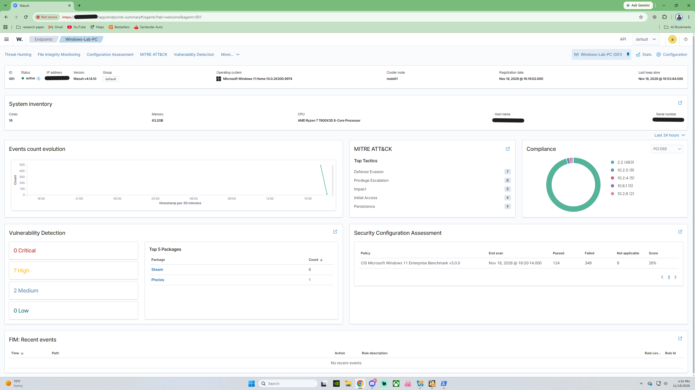
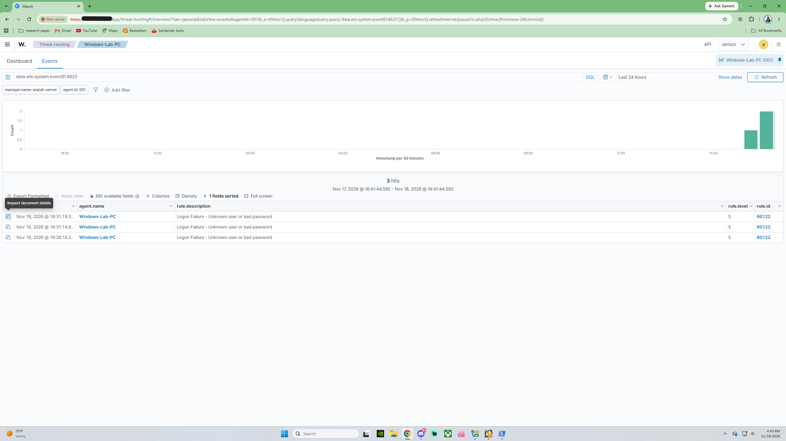
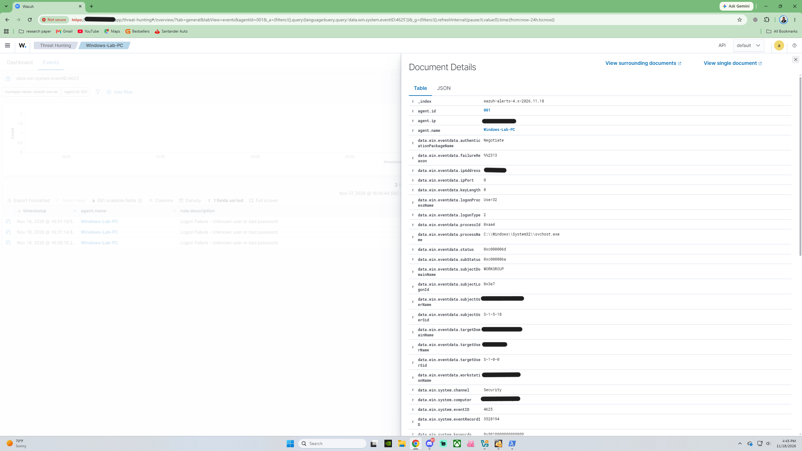
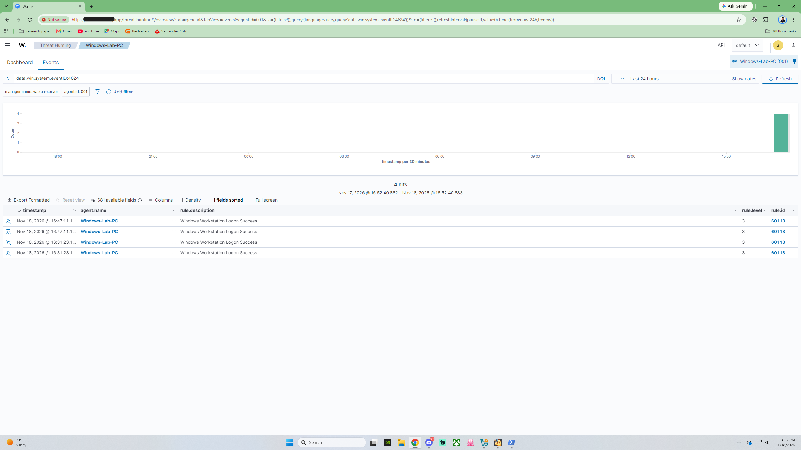
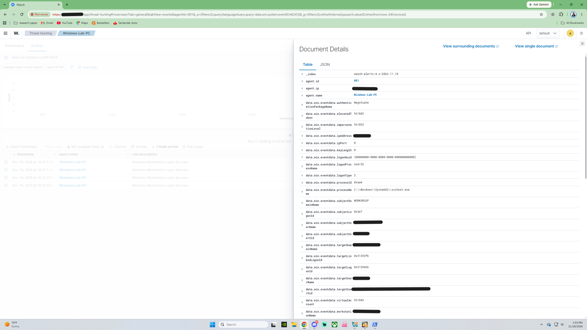

# Wazuh SIEM Home Lab

## Project Overview

For this project, I wanted to get some hands-on experience with security monitoring and log analysis. Since I'm interested in cybersecurity and SOC analyst roles, I decided to set up a home lab using Wazuh SIEM.

The goal was to monitor my Windows 11 computer, generate some test security events, and see how Wazuh detects and organizes them. I focused mainly on failed and successful login attempts, but I also spent some time looking into the vulnerability detection features.

## Tools Used

- **Wazuh 4.14.10:** SIEM platform used to collect and analyze security logs
- **Oracle VirtualBox:** Used to run the Wazuh virtual machine
- **Windows 11:** My computer, which served as the monitored endpoint
- **Wazuh Agent:** Installed on Windows to send security events to Wazuh
- **Windows PowerShell:** Used to search and verify Windows security logs

## Setting Up the Lab

I started by downloading the preconfigured Wazuh virtual machine and importing it into VirtualBox. I allocated 4 CPU cores, 8 GB of RAM, and 50 GB of storage.

Once the virtual machine was running, I accessed the Wazuh dashboard through my browser. I then installed the Wazuh agent on my Windows 11 computer and connected it to the server.

After getting everything connected, I checked the dashboard to make sure my Windows agent was active and sending information to Wazuh.

### Windows Agent Dashboard

## Investigation 1: Failed Login Attempts

For my first test, I wanted to see if Wazuh could detect failed login attempts on my computer.

I intentionally entered an incorrect password a few times at the Windows login screen. After signing back in, I used PowerShell to check whether Windows had recorded the failed attempts.

I found that Windows recorded these attempts under **Event ID 4625**, which represents a failed login.

I then went into Wazuh's Threat Hunting section and searched for:

`data.win.system.eventID:4625`

Wazuh showed three failed login alerts, which confirmed that the events were being collected and detected.

### What I Found

- **Event ID:** 4625 (Failed Login)
- **Wazuh Rule ID:** 60122
- **Alert Level:** 5
- **Logon Type:** 2 (Interactive)
- **Failure Reason:** Incorrect password
- **Source IP:** 127.0.0.1 (Localhost)

By looking through the event details, I was able to see which account was involved, what caused the login to fail, and where the attempt came from.

Since I intentionally generated these events, I knew they weren't actual attacks. However, in a real environment, repeated failed login attempts could be worth investigating, especially if they were followed by a successful login.

### Failed Login Alerts

### Failed Login Event Details

## Investigation 2: Successful Login

Next, I wanted to compare the failed login attempts with a successful one.

I locked my computer and signed back in using the correct password. I then used PowerShell to find **Event ID 4624**, which records successful Windows logins.

One thing I noticed was that Windows generates a lot of successful login events that aren't necessarily someone signing into the computer.

For example, I found an event with **Logon Type 5**, which means a Windows service logged in. After looking through the logs, I found another event with **Logon Type 2**, which represents an interactive login.

I searched Wazuh using:

`data.win.system.eventID:4624`

Wazuh also showed the successful authentication events.

### What I Found

- **Event ID:** 4624 (Successful Login)
- **Wazuh Rule ID:** 60118
- **Alert Level:** 3
- **Logon Type:** 2 (Interactive)
- **Result:** Successful authentication

This helped me understand why it's important to look at the details of a security event instead of just the event ID. Not every successful login event means someone actually sat down and signed into Windows.

It also showed me how a SOC analyst could compare failed and successful logins to look for potentially suspicious activity.

### Successful Login Alerts

### Successful Login Event Details

## Vulnerability Detection

While exploring the Wazuh dashboard, I noticed that it identified **7 high-severity and 2 medium-severity potential vulnerabilities** on my Windows computer.

The findings were associated with Steam and Microsoft Photos.

I wanted to see whether these were actual issues, so I checked Windows Update, Steam, and the Microsoft Store. All three showed that my software was fully updated.

I also noticed that Wazuh was reporting a different Steam version than the version displayed in the Steam client.

Because of that, I suspected some of the findings might be false positives. However, I couldn't confirm that without investigating the individual vulnerabilities further.

This was a useful part of the project because I learned that a security tool reporting a vulnerability doesn't automatically mean the system is compromised or that the finding is accurate. It's important to verify the results before deciding what action to take.

## What I Learned

This was my first time setting up my own SIEM lab, so I learned quite a bit just getting everything running.

Some of the main things I practiced were:

- Setting up and running a virtual machine in VirtualBox
- Installing and configuring Wazuh
- Connecting a Windows endpoint to a SIEM
- Using PowerShell to investigate Windows security logs
- Understanding Windows Event IDs 4624 and 4625
- Identifying different Windows logon types
- Filtering and examining security alerts in Wazuh
- Comparing failed and successful authentication events
- Checking and investigating potential software vulnerabilities

I also ran into a few issues along the way, especially when trying to generate and find specific login events. Working through those problems helped me better understand how Windows logging works and why troubleshooting is an important part of cybersecurity.

## Conclusion

Overall, this project gave me a better idea of how security monitoring works and what a SOC analyst might look for when investigating authentication activity.

Before doing this lab, I mostly understood these concepts from studying. Actually setting everything up, generating the events, and finding them in Wazuh helped me see how they work in practice.

My biggest takeaway was that detecting an alert is only part of the process. You also need to understand what caused it and whether it represents a real security concern.

All testing was performed on my own Windows computer in an authorized home lab.
